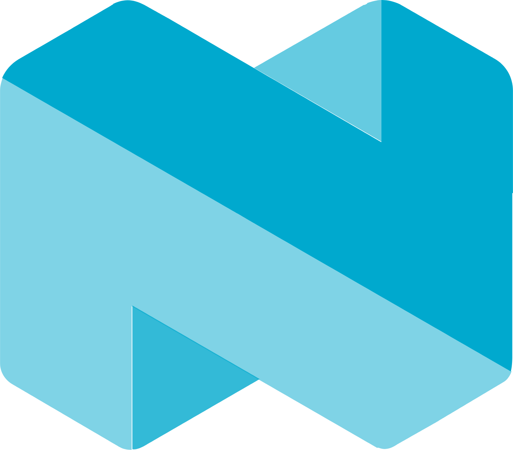

<h1 align="center">Hello everyone, I'm Andre Simao!  
  
</h1> 

  

   
  
  
  
  
  
  
  
  
  
  
  
  
   

  
#

  
  

#

  

###

  %20Shall%20we%20dive%20deep%20into%20knowledge?&font=Fira%20Code&Left=true&width=500&height=25&color=800080&vCenter=true&pause=5000&size=20"/>

